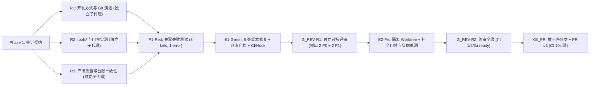

# 实战案例：用 `mission-orchestrator` 完成 `higgsfield-case-library` 全库质检、工具链修复与 PR #6

> 真实交付 PR：[`cuiyucheng0104-afk/higgsfield-case-library#6`](https://github.com/cuiyucheng0104-afk/higgsfield-case-library/pull/6)
> 分支：`feat/repo-harness-ci-2026-11` → `clean-history-2026-11`（`+1228 / -107`，35 个文件，GitHub Actions CI `10s` 全绿）

---

## 一、任务背景与契约（Phase 1）

目标：评估一个拥有 5,654 个已跟踪文件（含 101 篇案例笔记、4,336 个索引源码文件、14 个工具脚本、复杂脱敏与实验室体系）的研究库在**开发方式、多环节工程质量、产出一致性**上的真实水准，落地高杠杆工程改良并提 PR。

详见随附样本：
- [contract.yaml](contract.yaml)（`done_when` 五项硬验收标准 + `fence`/`forbidden` 围栏 + `undo_tier: cleanup`）
- [trace.jsonl](trace.jsonl)（从 `Phase1` 到 `G_REV-R2` 完整事件流）
- [review_report.md](review_report.md)（独立评审 Round 1 → 整改 → Round 2 终审四维度判定）

---

## 二、Graph 拓扑与端到端执行过程

### 1. 并行独立调研（`R1 / R2 / R3`）抓出的关键事实
- 仓库此前**零 CI、零激活 Git Hook、零工具单元测试**；
- `tools/参数/分级.py:121` 在系统 Python 3.9.6 直接 `SyntaxError`；
- `tools/脱敏/体检.py --全部` 漏调 `未跟踪()`，误扫 `.gitignore` 本地媒体报 230 条误报；
- `tools/脱敏/出库.py` 重复命中 `已出库.md`，且对 26 个技能包硬编码写死 `"无 LICENSE"`（实际 `源码索引/包索引.tsv` 实测 10 个包有许可文件）；
- `tools/对拍/比.sh` 超容差返回 `0` 违背契约；`tools/量测/跑量测.sh` 在 `size`（`W,H`）生成非法 JSON，且在 `LC_ALL=C` 下 `$UNIT（` 未加花括号触发 `unbound variable` 崩溃。

### 2. 先写失败测试（Red）→ 实施修复（Green）
- 编写零依赖标准库单测 `tests/test_repo_harness.py`，修改前运行实测 **`Ran 11 tests — FAILED (failures=8, errors=1)`**；
- 落地 6 处脚本修复、统一门禁 `tools/仓库自检.py`、`.github/workflows/ci.yml`、`.githooks/pre-commit` 与文档断链修复后，在 `Python 3.9.6 -I -B` 与默认 Python 下全部转绿。

### 3. 独立对抗评审 `G_REV` 的救命拦截（Round 1 → Round 2）
如果本轮没有**独立上下文只读评审（`G_REV`）**，将直接酿成一次严重混杂提交事故：
- **`[P0-1]` 捕获并发分支污染**：`G_REV` 通过 `git reflog` 发现另一并行窗口在共享工作树上往同分支推入了无关提交 `70d628e`（含 20 个本任务 `forbidden` 文件）。主控立即从干净基线 `9b7e5b6` 切出**物理隔离的 `git worktree`**（新分支 `feat/repo-harness-ci-2026-11`），彻底剥离他人改动；
- **`[P0-2]` 捕获契约围栏漂移**：强迫主控显式修订 `contract.yaml` 的 `fence`，杜绝隐性越界；
- **`[P1-1 / P1-2]` 补强空壳盲区**：在 `G_REV` 追问下补齐 `源码索引/` 磁盘同步核验、Python 3.9 AST 全量反斜杠检查、`体检.py` 临时 git 仓负向泄露 `exit 1` 夹具及 `LC_ALL=C` 下 `跑量测.sh` 实测。

---

## 三、沉淀回 `mission-orchestrator` v2.0 的关键教训

1. **隔离 Worktree 前置铁律**：所有代码/PR 长任务必须在独立 `git worktree` 进行，禁止与其它并发会话共用同一工作树 `HEAD`；
2. **跨环境红队测试**：脚本类项目必须把 `python3 -I`（最小兼容版本）、`LC_ALL=C`、无选装二进制环境纳入必测矩阵；
3. **防止 `.kb/.obsidian-sync.json` 污染提交**：`init_kb.py` 自动生成 `.kb/.gitignore` 屏蔽 `.obsidian-sync.json`，`sync_obsidian.py` 新增 `--no-record` 选项。
